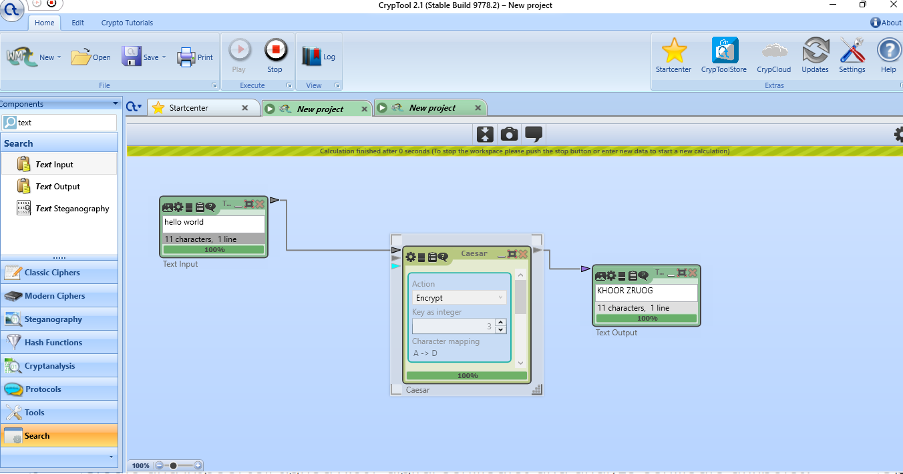
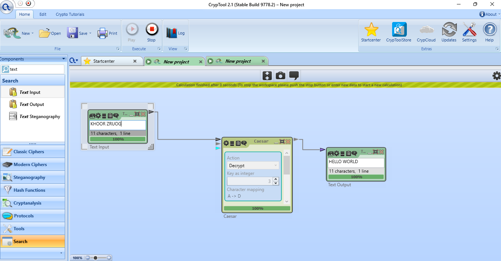
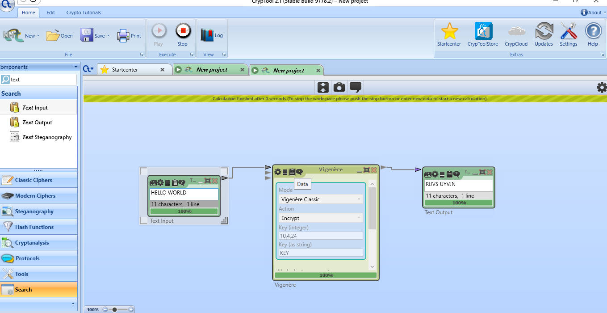
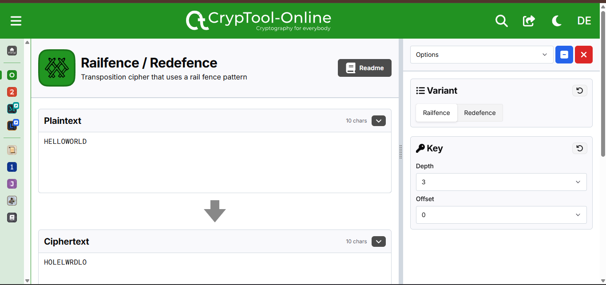
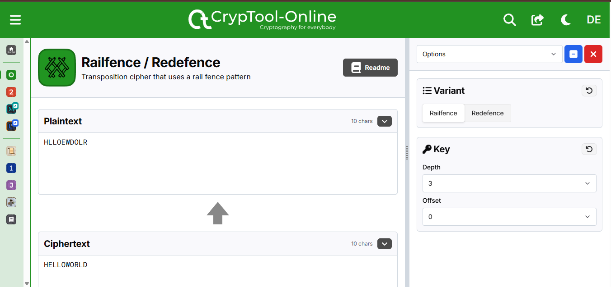

# Experiment 1: Implementation of Caesar, Vigenère, and Rail Fence Ciphers

## 1. Aim

To implement Caesar, Vigenère, and Rail Fence ciphers to encrypt and decrypt the given plaintext `HELLO WORLD` and compare their working and effectiveness.

## 2. Software/Tool Required

- CrypTool 2.1 – For Caesar Cipher and Vigenère Cipher.
- CrypTool Online – For Rail Fence Cipher.
- Web Browser – To access CrypTool Online.

## 3. Algorithms

### A. Caesar Cipher

1. Take the plaintext `HELLO WORLD`.
2. Choose a shift value of 3.
3. Replace each letter with the letter three positions ahead in the alphabet.
4. Keep the space between the words.
5. To decrypt, shift each ciphertext letter three positions backward.

**Plaintext:** `HELLO WORLD`  
**Key:** `3`  
**Ciphertext:** `KHOOR ZRUOG`

### B. Vigenère Cipher

1. Take the plaintext `HELLO WORLD`.
2. Use the key `KEY`.
3. Repeat the key over the plaintext letters, ignoring spaces when applying the key.
4. Shift each plaintext letter according to the corresponding key letter.
5. Combine the resulting letters to obtain the ciphertext.
6. To decrypt, reverse the shifts using the same key.

**Plaintext:** `HELLO WORLD`  
**Key:** `KEY`  
**Ciphertext:** `RIJVS UYVJN`

### C. Rail Fence Cipher

1. Take the plaintext `HELLO WORLD`, removing the space.
2. Set the depth to 3.
3. Arrange the letters in a zigzag pattern across three rails.
4. Read the letters row by row to obtain the ciphertext.
5. To decrypt, use the same depth to rearrange the letters and recover the original plaintext.

**Plaintext:** `HELLOWORLD`  
**Depth:** `3`  
**Offset:** `0`

## 4. Working Procedure

### A. Caesar Cipher

1. Open CrypTool 2.1.
2. Select the Caesar Cipher component.
3. Enter the plaintext `HELLO WORLD`.
4. Set the shift value to 3.
5. Perform encryption and record the ciphertext.
6. Decrypt the ciphertext using the same shift value.
7. Verify that the original plaintext is recovered.

### B. Vigenère Cipher

1. Open CrypTool 2.1.
2. Select the Vigenère Cipher component.
3. Enter the plaintext `HELLO WORLD`.
4. Enter the key `KEY`.
5. Perform encryption and record the ciphertext.
6. Decrypt the ciphertext using the same key.
7. Verify that the original plaintext is recovered.

### C. Rail Fence Cipher

1. Open the Rail Fence Cipher tool on CrypTool Online.
2. Enter the plaintext `HELLOWORLD`.
3. Set the depth to 3 and offset to 0.
4. Encrypt the plaintext and record the ciphertext.
5. Enter the ciphertext into the decryption tool with the same depth.
6. Verify that the decrypted text is `HELLOWORLD`.

## 5. Screenshots

### A. Caesar Cipher

#### Encryption Output

#### Decryption Output

### B. Vigenère Cipher

#### Encryption Output

#### Decryption Output

### C. Rail Fence Cipher

#### Encryption Output

#### Decryption Output

## 6. Comparison of Working and Effectiveness

| Cipher | Working Method | Effectiveness |
|---|---|---|
| Caesar Cipher | Shifts each letter by a fixed number of positions. | Easy to use, but easily broken because of its small key space. |
| Vigenère Cipher | Uses a repeating keyword to determine the shift for each letter. | More resistant than Caesar to simple frequency analysis, but vulnerable to attacks on repeated-key patterns. |
| Rail Fence Cipher | Arranges letters in a zigzag pattern and reads them row by row. | Rearranges letter positions but provides weak security. |

### Explanation

- **Caesar Cipher:** Changes each letter according to a fixed shift.
- **Vigenère Cipher:** Uses a keyword to apply different shifts to letters.
- **Rail Fence Cipher:** Keeps letters unchanged but rearranges their positions.

These classical ciphers demonstrate basic encryption techniques but are not suitable for modern secure communication.

## 7. Result

Caesar, Vigenère, and Rail Fence ciphers were implemented for encryption and decryption. Their working methods and effectiveness were compared.

Caesar uses a fixed shift, Vigenère uses a repeating keyword, and Rail Fence rearranges the positions of letters.

## 8. Conclusion

The experiment demonstrated substitution and transposition techniques in classical cryptography. The results show that these ciphers are useful for understanding encryption fundamentals but have significant security limitations.
