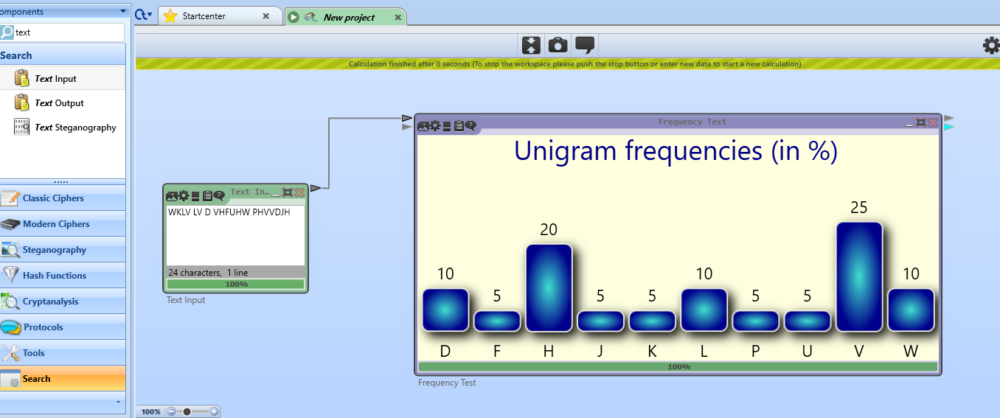

# Experiment 2: Frequency Analysis of Classical Ciphers

## 1. Aim

To perform frequency analysis on classical ciphertexts and analyze their vulnerability to cryptanalysis attacks using CrypTool.

## 2. Software/Tool Required

- CrypTool 2.1
- Windows operating system

## 3. Theory

Frequency analysis is a cryptanalysis technique used to examine how frequently letters occur in ciphertext.

In English, letters such as E, T, A, O, and I commonly occur frequently. Simple substitution ciphers preserve the frequency pattern of letters, making them vulnerable to statistical analysis.

## 4. Working Procedure

1. Open CrypTool 2.1.
2. Add a Text Input component.
3. Enter the sample ciphertext.
4. Add the Frequency Test component.
5. Connect Text Input to Frequency Test.
6. Run the workspace.
7. Observe the unigram frequency graph.
8. Record the frequency distribution and analyze the results.

## 5. Input

Sample ciphertext:

`WKLV LV D VHFUHW PHVVDJH`

## 6. Output

The Frequency Test component displays a unigram frequency graph showing the percentage frequency of letters in the input ciphertext.

### Observations

According to the captured graph:

- V has a frequency of 25%.
- H has a frequency of 20%.
- D, L, and W each have a frequency of 10%.
- F, J, K, P, and U each have a frequency of 5%.

## 7. Analysis

Frequency analysis can help identify patterns in classical ciphertexts.

In a Caesar cipher, each plaintext letter is shifted by a fixed number of positions. The relative frequency pattern is preserved, although the letters change.

Short ciphertexts may not provide sufficient statistical evidence for reliable cryptanalysis.

## 8. Screenshot

## 9. Result

The Frequency Test component was used to visualize letter frequencies in the sample ciphertext. The observed frequency distribution demonstrates how statistical analysis can help identify patterns in classical ciphers.

## 10. Conclusion

Frequency analysis is useful for studying the weaknesses of classical substitution ciphers. Modern cryptographic algorithms are designed to resist these types of statistical attacks.
