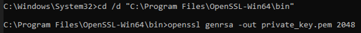
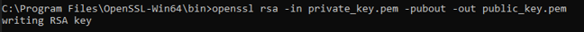
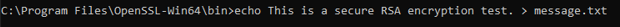
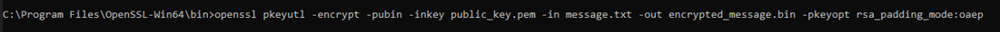
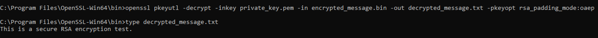

# Experiment 4: RSA Key Generation, Encryption, and Decryption

## 1. Aim

To implement the RSA (Rivest–Shamir–Adleman) asymmetric cryptosystem using OpenSSL by generating 2048-bit public and private key pairs, encrypting a plaintext message with the public key, and decrypting the ciphertext with the private key using OAEP padding to verify data confidentiality and integrity.

## 2. Software/Tool Required

- **OpenSSL** (OpenSSL-Win64 v3.x / v1.1.x)
- **Windows Command Prompt / PowerShell**
- **Operating System:** Windows 10/11

## 3. Theory

### A. Asymmetric Cryptography
Unlike symmetric ciphers that use a single shared secret key, asymmetric cryptography uses a mathematically linked key pair:
- **Public Key:** Shared openly and used to encrypt messages.
- **Private Key:** Kept strictly secret by the owner and used to decrypt messages.

### B. Mathematical Foundation of RSA
RSA security relies on the computational difficulty of the **Integer Factorization Problem**:
1. **Select Primes:** Choose two distinct large prime numbers, $p$ and $q$.
2. **Compute Modulus:** Calculate $n = p \times q$. The bit-length of $n$ defines the key length (e.g., 2048 bits).
3. **Euler’s Totient Function:** Compute $\phi(n) = (p - 1)(q - 1)$.
4. **Choose Public Exponent ($e$):** Select an integer $e$ such that $1 < e < \phi(n)$ and $\gcd(e, \phi(n)) = 1$. Commonly, $e = 65537$ ($2^{16} + 1$).
5. **Compute Private Exponent ($d$):** Determine $d$ satisfying $d \cdot e \equiv 1 \pmod{\phi(n)}$ using the Extended Euclidean Algorithm.
6. **Key Pairs:**
   - **Public Key:** $(e, n)$
   - **Private Key:** $(d, n)$

### C. Encryption and Decryption
- **Encryption:** Given plaintext message $M$ (where $0 \le M < n$):
  $$C \equiv M^e \pmod{n}$$
- **Decryption:** Given ciphertext $C$:
  $$M \equiv C^d \pmod{n}$$

### D. OAEP Padding (Optimal Asymmetric Encryption Padding)
Raw (textbook) RSA is deterministic and vulnerable to mathematical attacks. OAEP padding introduces probabilistic randomness before encryption, preventing chosen-ciphertext attacks (CCA) and replay attacks.

---

## 4. Working Procedure & Commands

### Step 1: Generate 2048-bit RSA Private Key
Open the terminal, navigate to the OpenSSL binary folder, and generate a 2048-bit RSA private key:
```cmd
cd /d "C:\Program Files\OpenSSL-Win64\bin"
openssl genrsa -out private_key.pem 2048
```

### Step 2: Extract the Corresponding Public Key
Extract the public key component from the generated private key file:
```cmd
openssl rsa -in private_key.pem -pubout -out public_key.pem
```

### Step 3: Create Sample Plaintext Message
Create a text file containing the message to be encrypted:
```cmd
echo This is a secure RSA encryption test. > message.txt
```

### Step 4: Encrypt the Message using Public Key
Encrypt the text file using `pkeyutl` with the recipient's public key and OAEP padding mode:
```cmd
openssl pkeyutl -encrypt -pubin -inkey public_key.pem -in message.txt -out encrypted_message.bin -pkeyopt rsa_padding_mode:oaep
```

### Step 5: Decrypt the Ciphertext using Private Key
Decrypt the binary ciphertext using the private key and verify the recovered message:
```cmd
openssl pkeyutl -decrypt -inkey private_key.pem -in encrypted_message.bin -out decrypted_message.txt -pkeyopt rsa_padding_mode:oaep
type decrypted_message.txt
```

---

## 5. Input and Artifact Details

| Item | File Name | Format | Details |
|---|---|---|---|
| **Private Key** | `private_key.pem` | PEM (Base64) | 2048-bit RSA private key |
| **Public Key** | `public_key.pem` | PEM (Base64) | 2048-bit RSA public key |
| **Plaintext Input** | `message.txt` | Text | `This is a secure RSA encryption test.` |
| **Ciphertext Output**| `encrypted_message.bin` | Binary (256 bytes) | Encrypted message block |
| **Decrypted Output** | `decrypted_message.txt` | Text | `This is a secure RSA encryption test.` |

---

## 6. Screenshots

### Step 1: RSA Private Key Generation


### Step 2: RSA Public Key Generation


### Step 3: Message File Creation


### Step 4: RSA Encryption with OAEP Padding


### Step 5: RSA Decryption and Verification


---

## 7. Result

The 2048-bit RSA key pair was successfully generated using OpenSSL. The plaintext message was encrypted using the public key with OAEP padding and subsequently decrypted using the private key, completely recovering the original plaintext.

---

## 8. Conclusion

The experiment successfully demonstrated the principles and practical execution of the RSA public-key cryptosystem. Asymmetric cryptography eliminates the requirement for exchanging a secret key over an insecure channel, making RSA a cornerstone for secure digital communication, SSL/TLS handshakes, and digital signatures.

---

## 10. Security Note

The RSA private key (`private_key.pem`) is confidential and must never be committed or uploaded to a public repository. Only the public key (`public_key.pem`) and sample ciphertext/plaintext files should be shared. Always ensure that private-key patterns are listed in `.gitignore` to prevent accidental disclosure.
