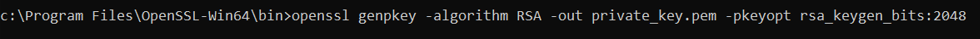
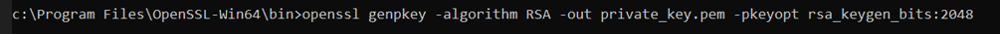
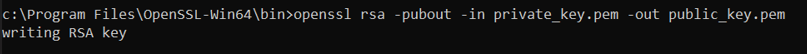
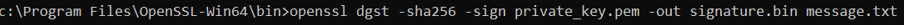
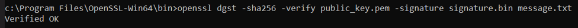
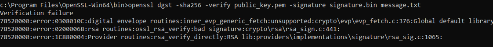

# Experiment 5: SHA-256 Hashing and Digital Signature Verification

## Aim
To generate SHA-256 hash values, create digital signatures using RSA private keys, and verify their authenticity and integrity using OpenSSL.

## Tools Required
- OpenSSL
- Windows Command Prompt (CMD)
- Visual Studio Code 

## Theory
SHA-256 is a cryptographic hash function that generates a fixed-length 256-bit digest from input data. A digital signature uses a private key to sign data and a corresponding public key to verify the signature.

Digital signatures help ensure data integrity and authenticity. If the signed message is modified, signature verification fails.

## Algorithm
1. Check the OpenSSL installation.
2. Create a sample text file named `message.txt`.
3. Generate the SHA-256 hash of the message.
4. Generate a 2048-bit RSA private key.
5. Extract the corresponding public key.
6. Create a digital signature using the private key.
7. Verify the signature using the public key.
8. Modify the original message.
9. Verify the signature again and observe the verification failure.

## Procedure and Screenshots

### Step 1: Create the Message File

Command:
```cmd
echo Welcome to Cryptography Laboratory.>message.txt
```


### Step 2: Generate SHA-256 Hash

Command:
```cmd
openssl dgst -sha256 message.txt
```



### Step 3: Generate RSA Private Key

Command:
```cmd
openssl genpkey -algorithm RSA -out private_key.pem -pkeyopt rsa_keygen_bits:2048
```



### Step 4: Generate RSA Public Key

Command:
```cmd
openssl rsa -pubout -in private_key.pem -out public_key.pem
```



### Step 5: Create Digital Signature

Command:
```cmd
openssl dgst -sha256 -sign private_key.pem -out signature.bin message.txt
```



### Step 6: Verify Digital Signature

Command:
```cmd
openssl dgst -sha256 -verify public_key.pem -signature signature.bin message.txt
```

Expected output:
```text
Verified OK
```



### Step 7: Modify the Message

Command:
```cmd
echo Welcome to Cryptography Lab.>message.txt
```

### Step 8: Verify the Modified Message

Command:
```cmd
openssl dgst -sha256 -verify public_key.pem -signature signature.bin message.txt
```

Expected result: Signature verification fails because the message has changed.



## Result
SHA-256 hashing and RSA digital signature generation and verification were performed using OpenSSL. The original message was verified successfully, while verification failed after the message was modified.

## Conclusion
This experiment demonstrates how SHA-256 generates a fixed-length message digest and how RSA digital signatures help verify message integrity and authenticity. Modifying a signed message causes signature verification to fail.

## Security Note
The RSA private key (`private_key.pem`) is confidential and must never be committed or uploaded to a public repository. Only the public key (`public_key.pem`), sample message, and signature files can be safely shared. Always configure `.gitignore` to prevent tracking private keys.
