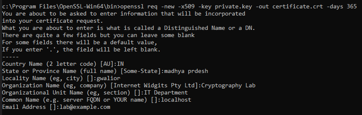
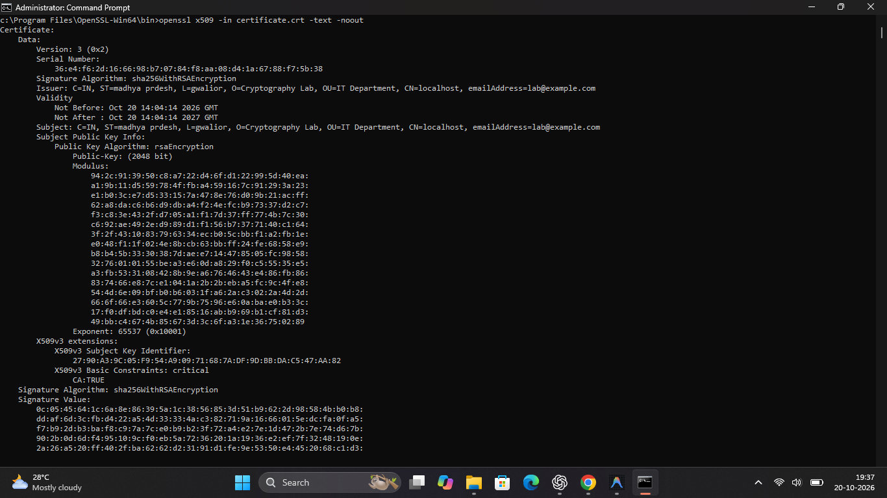
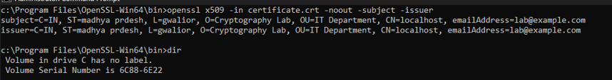

# Experiment 6: Create and Inspect Self-Signed X.509 Digital Certificates

## Aim
To create and inspect a self-signed X.509 digital certificate using OpenSSL.

## Requirements
- OpenSSL
- Windows Command Prompt (CMD)

## Introduction
An X.509 digital certificate verifies an identity and contains a public key. It is mainly used in HTTPS/SSL/TLS for secure communication.

## Procedure and Screenshots

### Step 1: Generate a Private Key

Command:
```cmd
openssl genrsa -out private.key 2048
```

This command generates a 2048-bit RSA private key.


### Step 2: Create a Self-Signed Certificate

Command:
```cmd
openssl req -new -x509 -key private.key -out certificate.crt -days 365
```

Enter the required details, such as Country, Organization, and Common Name (CN).



### Step 3: Inspect the Certificate

Command:
```cmd
openssl x509 -in certificate.crt -text -noout
```

Observe the following attributes:
- Subject
- Issuer
- Serial Number
- Validity Period
- Public Key
- Signature Algorithm



### Step 4: Check Subject and Issuer

Command:
```cmd
openssl x509 -in certificate.crt -noout -subject -issuer
```

For a self-signed certificate, the Subject and Issuer identify the same entity.



## Result
A self-signed X.509 digital certificate was created successfully, and its important attributes were inspected using OpenSSL.

## Conclusion
This experiment demonstrates how to create and inspect a self-signed X.509 digital certificate using OpenSSL. The certificate contains identity information and a public key and can be used in testing and laboratory environments.

## Security Note
The private key (`private.key`) is confidential and must never be committed or uploaded to a public repository. The generated digital certificate (`certificate.crt`) contains only the public key and identity information and can be safely distributed. Always ensure `.gitignore` is configured to prevent tracking private keys.
