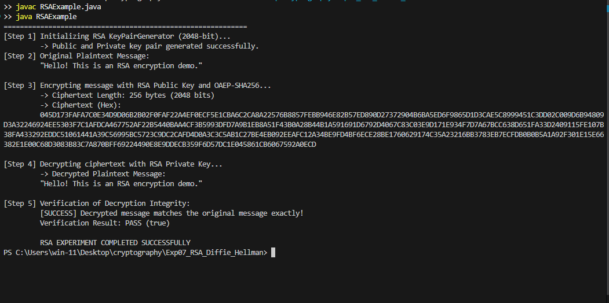
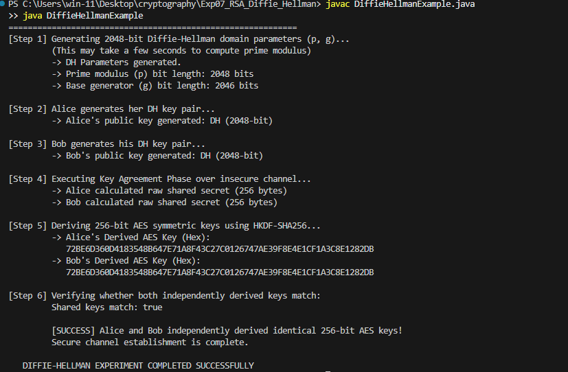

# Experiment 7: Implementation of RSA and Diffie-Hellman Using Java

## 1. Aim

To implement RSA encryption and decryption and Diffie-Hellman key exchange using Java and understand their role in secure communication.

## 2. Tools Required

- Operating System: Windows
- Java Development Kit (JDK)
- Visual Studio Code
- Java Cryptography Architecture (JCA)
- Java Cryptography Extension (JCE)

## 3. Experiment 7A: RSA Encryption and Decryption

### Theory

RSA (Rivest-Shamir-Adleman) is an asymmetric cryptographic algorithm that uses two keys: a public key and a private key. The public key is used to encrypt a message, while the corresponding private key is used to decrypt it.

In this experiment, a 2048-bit RSA key pair is generated. The message is encrypted using OAEP padding with SHA-256 and then decrypted using the private key.

### Algorithm

1. Import the required Java cryptography classes.
2. Generate an RSA key pair with a key size of 2048 bits.
3. Obtain the public and private keys.
4. Define the original message.
5. Encrypt the message using the public key and OAEP padding.
6. Decrypt the ciphertext using the private key.
7. Display the original, encrypted, and decrypted messages.
8. Verify that the decrypted message matches the original message.

### Procedure

1. Open Visual Studio Code.
2. Create a Java file named `RSAExample.java`.
3. Write the RSA encryption and decryption program.
4. Save the program.
5. Open the terminal in the experiment directory.
6. Compile the program:

   ```bash
   javac RSAExample.java
   ```

7. Execute the program:

   ```bash
   java RSAExample
   ```

8. Observe the output and verify that the decrypted message matches the original message.

## 4. Experiment 7B: Diffie-Hellman Key Exchange

### Theory

Diffie-Hellman is a cryptographic key exchange algorithm that allows two parties to establish a shared secret over an insecure communication channel.

In this experiment, Alice and Bob independently generate their private and public keys. Each party calculates a shared secret using its own private key and the other party's public key. A key derivation function can then derive a usable key from the shared secret.

### Algorithm

1. Generate Diffie-Hellman parameters.
2. Generate Alice's private and public keys.
3. Generate Bob's private and public keys.
4. Calculate Alice's shared secret using Bob's public key.
5. Calculate Bob's shared secret using Alice's public key.
6. Derive keys from the shared secrets.
7. Compare the derived keys.
8. Display the results and verify that both keys match.

### Procedure

1. Create a Java file named `DiffieHellmanExample.java`.
2. Write the Diffie-Hellman key exchange program.
3. Save the program.
4. Open the terminal in the experiment directory.
5. Compile the program:

   ```bash
   javac DiffieHellmanExample.java
   ```

6. Execute the program:

   ```bash
   java DiffieHellmanExample
   ```

7. Observe the derived keys for Alice and Bob.
8. Verify that both derived keys match.

## 5. Screenshots

### RSA Encryption and Decryption

The following screenshot demonstrates RSA encryption and decryption using Java.



### Diffie-Hellman Key Exchange

The following screenshot demonstrates the Diffie-Hellman key exchange and verification of the shared keys.



## 6. Result

RSA encryption and decryption were implemented using Java. The original message was encrypted using the public key and recovered using the corresponding private key.

The Diffie-Hellman key exchange was also implemented. Both parties independently derived matching keys, confirming successful key establishment.

## 7. Conclusion

This experiment demonstrates two important cryptographic techniques used in secure communication. RSA provides asymmetric encryption and decryption, while Diffie-Hellman allows two parties to establish a shared secret. The experiment provides practical understanding of public-key cryptography and secure key exchange.