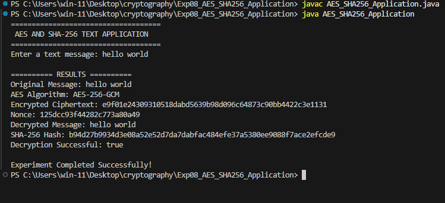

# Experiment 8: AES and SHA-256 Text Message Application Using Java

## 1. Aim
To develop a Java application that encrypts and decrypts text messages using the AES algorithm and generates a SHA-256 hash to demonstrate secure data processing.

## 2. Tools Required
- Operating System: Windows
- Programming Language: Java
- Java Development Kit (JDK)
- Visual Studio Code
- Java Cryptography Architecture (JCA)
- Java Cryptography Extension (JCE)

## 3. Algorithm

### AES Encryption and Decryption
1. Start the program.
2. Accept a text message from the user.
3. Generate a secure 256-bit AES secret key.
4. Generate a random 12-byte nonce.
5. Initialize the AES cipher using `AES/GCM/NoPadding`.
6. Encrypt the message using the AES key and nonce.
7. Decrypt the ciphertext using the same key and nonce.
8. Display the original message, encrypted ciphertext, and decrypted message.
9. Compare the original and decrypted messages.
10. Display whether decryption was successful.

### SHA-256 Hash Generation
1. Take the original text message as input.
2. Initialize the SHA-256 message digest.
3. Calculate the hash of the message.
4. Convert the hash into hexadecimal format.
5. Display the generated SHA-256 hash.
6. Stop the program.

## 4. Screenshot

The following screenshot demonstrates AES encryption, decryption,
and SHA-256 hash generation using Java.

## 5. Result
The Java application demonstrates AES-256-GCM encryption and decryption and SHA-256 hash generation. The decrypted message matches the original message, confirming successful encryption and decryption. The SHA-256 algorithm generates a 256-bit hash of the input message.

## 6. Conclusion
This experiment demonstrates the practical implementation of symmetric encryption and cryptographic hashing using Java. AES-256-GCM provides confidentiality and integrity protection, while SHA-256 generates a fixed-length hash for data verification. Thus, AES encryption, decryption, and SHA-256 hashing were implemented successfully.