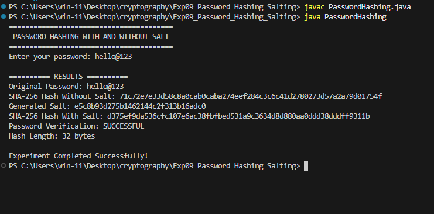

# Experiment 9: Password Hashing with and without Salt

## Aim
To implement password hashing using the SHA-256 algorithm and compare password hashing with and without a randomly generated salt.

## Tools Required
- Java Development Kit (JDK)
- Visual Studio Code
- Java Programming Language
- SHA-256 Hashing Algorithm

## Algorithm
1. Start the program.
2. Accept a password from the user.
3. Convert the password into bytes using UTF-8 encoding.
4. Generate the SHA-256 hash of the password without salt.
5. Generate a random 16-byte salt using SecureRandom.
6. Combine the salt with the password.
7. Generate the SHA-256 hash of the salted password.
8. Verify the password by generating its hash again using the same salt.
9. Compare the hashes to verify the password.
10. Display the original password, hashes, generated salt, and verification result.
11. Stop the program.

## Screenshot

## Result
Password hashing using SHA-256 was implemented successfully. The program generated a hash without salt and a salted hash. Password verification was successful, and the hash length was displayed as 32 bytes.

## Conclusion
This experiment demonstrates password hashing using SHA-256 with and without salt. Adding a random salt helps prevent identical passwords from always producing the same hash when different salts are used.

SHA-256 is used here for educational purposes. Real-world password storage should use dedicated password-hashing algorithms such as Argon2id, scrypt, or PBKDF2 with an appropriate work factor.
