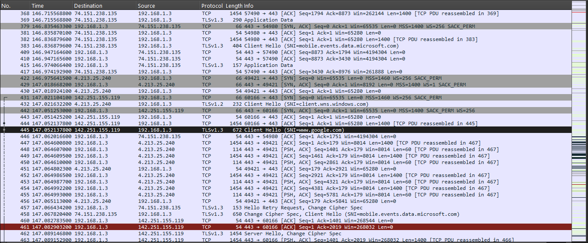
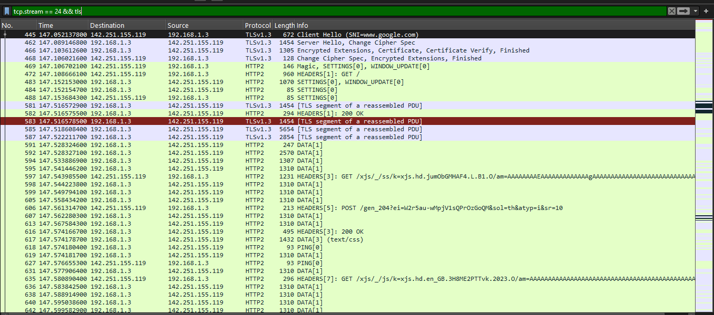
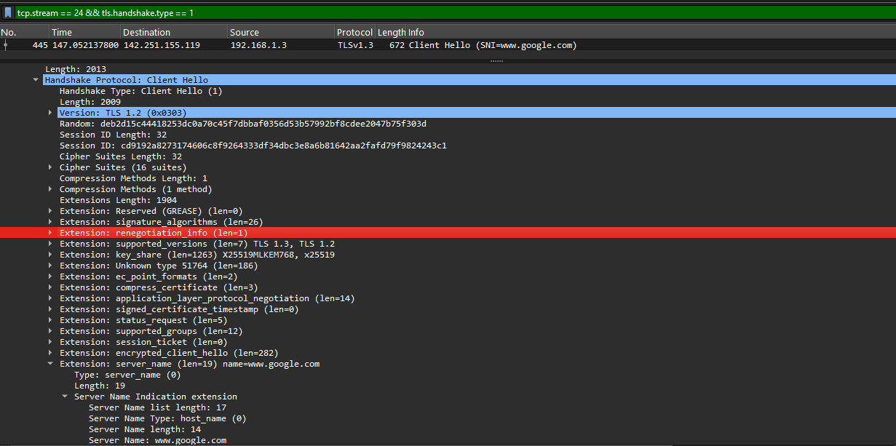
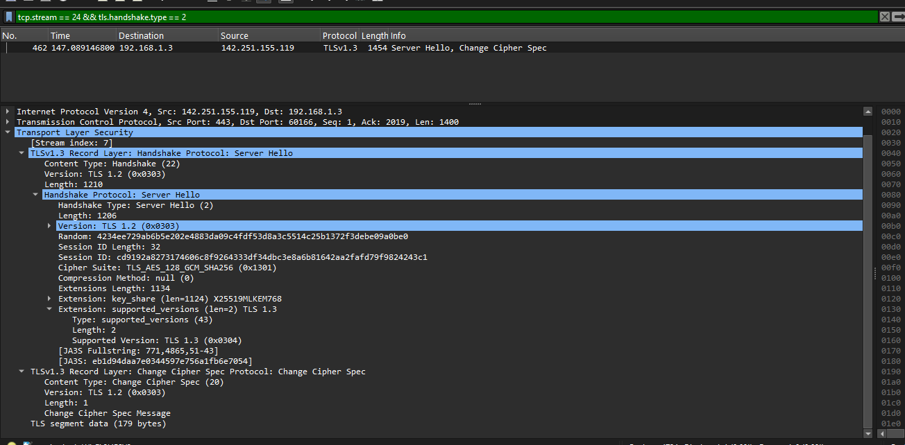
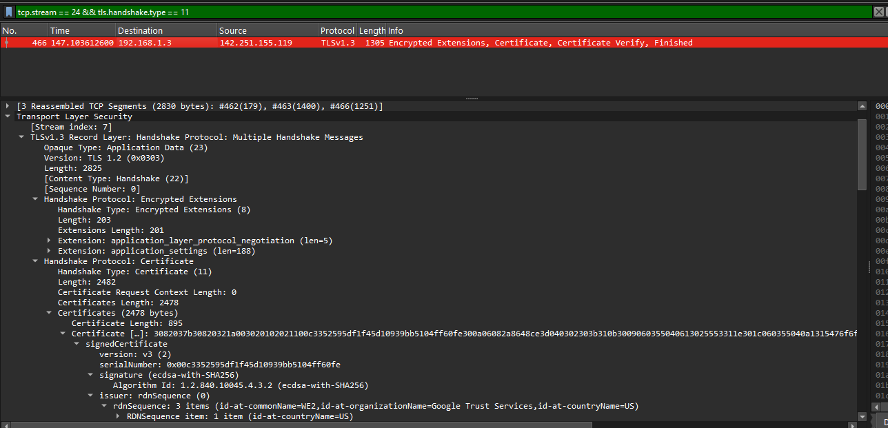
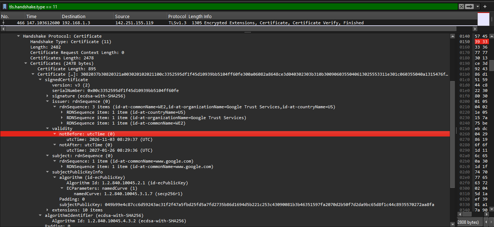

# Experiment 10: Capture HTTPS Traffic and Identify TLS Handshake, Certificates and Cipher Suites

## 1. Aim

To capture HTTPS traffic using Wireshark and analyze the TLS handshake process by identifying Client Hello, Server Hello, digital certificates, negotiated TLS version, and selected cipher suite. The experiment also examines X.509 certificate information, including the Subject, Issuer, Validity Period, Public Key Algorithm, and Signature Algorithm.

## 2. Software/Tools Required

- **Wireshark:** Network packet capture and protocol analysis.
- **Google Chrome:** Web browser for generating HTTPS traffic.
- **Windows PowerShell:** Configuring TLS session key logging.
- **Operating System:** Windows 10/11.
- **Internet Connection:** Required for accessing HTTPS websites.
- **Website Used:** www.google.com

---

## 3. Theory

### A. HTTPS (Hypertext Transfer Protocol Secure)

HTTPS is the secure version of HTTP. It uses Transport Layer Security (TLS) to protect communication between a web browser and a web server.

HTTPS provides three important security properties:

1. **Confidentiality:** Protects transmitted information from unauthorized reading.
2. **Integrity:** Helps detect unauthorized modification of transmitted data.
3. **Authentication:** Verifies the identity of the server using digital certificates.

HTTPS commonly operates over TCP port 443.

### B. Transport Layer Security (TLS)

TLS is a cryptographic protocol used to establish secure communication over a network.

TLS provides:

- Encryption of transmitted information.
- Authentication using digital certificates.
- Integrity protection.
- Secure establishment of session keys.

In this experiment, the negotiated TLS version was **TLS 1.3**.

### C. TLS Handshake Process

The TLS handshake establishes the security parameters required for encrypted communication.

**1. Client Hello**

The client initiates communication by sending a Client Hello message containing:

- Supported TLS versions.
- Supported cipher suites.
- Random value.
- Cryptographic extensions.
- Server Name Indication (SNI).

**2. Server Hello**

The server responds with a Server Hello message containing:

- Selected TLS version.
- Selected cipher suite.
- Server random value.
- Key exchange information.

**3. Digital Certificate**

The server sends its digital certificate to provide authentication information.

In TLS 1.3, the Certificate message is encrypted after the Server Hello.

**4. Certificate Verify**

The server proves possession of the private key associated with its certificate by signing handshake-related data.

**5. Finished**

The Finished message verifies the integrity of the handshake and confirms that the required cryptographic keys have been established.

### D. Digital Certificate (X.509)

An X.509 digital certificate binds a public key to an identity.

It contains information such as:

- Certificate Subject.
- Certificate Issuer.
- Validity Period.
- Public Key Algorithm.
- Signature Algorithm.

Digital certificates help browsers authenticate HTTPS servers.

### E. TLS Cipher Suite

A cipher suite specifies cryptographic algorithms used to secure TLS communication.

**Selected Cipher Suite:**

`TLS_AES_128_GCM_SHA256`

Components:

- **AES-128:** Symmetric encryption algorithm.
- **GCM:** Authenticated encryption mode providing confidentiality and integrity.
- **SHA-256:** Hash function used in TLS 1.3 key derivation and handshake operations.

---

## 4. Working Procedure & Commands

### Step 1: Start Wireshark

1. Open Wireshark.
2. Select the active Wi-Fi network interface.
3. Start capturing network packets.
4. Open Google Chrome.
5. Visit the HTTPS website.
6. Stop the capture after generating traffic.

**Website:**

`https://www.google.com`

### Step 2: Display HTTPS Traffic

Apply the following Wireshark display filter:

```text
tcp.port == 443
```

This filter displays TCP packets associated with port 443.

To display TLS packets, use:

```text
tls
```

### Step 3: Identify Client Hello

Apply:

```text
tls.handshake.type == 1
```

Select the Google Client Hello packet.

Expand:

**Transport Layer Security → Handshake Protocol: Client Hello**

Observe:

- Handshake Type.
- Supported TLS Versions.
- Cipher Suites.
- Extensions.
- Server Name.

**Observed Client Hello Packet:** 445

**Supported Versions:** TLS 1.3 and TLS 1.2

**Cipher Suites Offered:** 16

**Server Name:** www.google.com

### Step 4: Identify Server Hello

Apply:

```text
tls.handshake.type == 2
```

Select the Google Server Hello packet.

Expand:

**Transport Layer Security → Handshake Protocol: Server Hello**

Observe:

- Negotiated TLS Version.
- Selected Cipher Suite.
- Compression Method.
- Key Share Group.

**Observed Server Hello Packet:** 462

**Negotiated TLS Version:** TLS 1.3

**Selected Cipher Suite:** TLS_AES_128_GCM_SHA256

**Cipher Suite Code:** 0x1301

**Key Share Group:** X25519MLKEM768

**Note:** The Server Hello legacy version field displays TLS 1.2, while the Supported Versions extension confirms TLS 1.3.

### Step 5: Configure TLS Session Key Logging

TLS 1.3 encrypts the Certificate handshake message.

To inspect the encrypted handshake, TLS session key logging was configured in Google Chrome.

Open Windows PowerShell and execute:

```powershell
$env:SSLKEYLOGFILE = "C:\Users\win-11\Desktop\cryptography\tls-keys.log"
```

Verify the environment variable:

```powershell
echo $env:SSLKEYLOGFILE
```

Launch Google Chrome with a separate temporary profile:

```powershell
Start-Process "C:\Program Files\Google\Chrome\Application\chrome.exe" -ArgumentList "--user-data-dir=$env:TEMP\ChromeTLSExperiment10"
```

The TLS key log file was generated successfully.

**Wireshark Configuration:**

Navigate to:

**Edit → Preferences → Protocols → TLS**

Configure:

**(Pre)-Master-Secret log filename**

Select the generated `tls-keys.log` file.

The session keys allow Wireshark to decrypt supported TLS traffic captured from the corresponding browser sessions.

### Step 6: Capture and Decrypt HTTPS Traffic

1. Disable QUIC in the experimental Chrome profile.
2. Start a fresh Wireshark capture.
3. Open www.google.com.
4. Stop the capture.
5. Confirm that TLS handshake packets are visible.
6. Verify that Wireshark successfully decrypts the TLS 1.3 Certificate message.

Apply:

```text
tls.handshake.type == 11
```

**Observed Certificate Packet:** 466

**Handshake Type:** Certificate (11)

**Certificate Message Length:** 2482 bytes

**Certificates Length:** 2478 bytes

### Step 7: Examine Certificate Information

Select Packet 466.

Expand:

**Transport Layer Security → Handshake Protocol: Certificate → Certificates → Certificate**

Examine the X.509 certificate fields.

The following information was observed:

- Certificate Version: X.509 v3.
- Subject: CN=www.google.com.
- Issuer: Google Trust Services (WE2).
- Valid From: 03 November 2026.
- Valid To: 26 January 2027.
- Public Key Algorithm: Elliptic Curve (id-ecPublicKey).
- Named Curve: secp256r1.
- Signature Algorithm: ecdsa-with-SHA256.

### Step 8: Analyze the Same TLS Connection

To isolate the verified Google HTTPS connection, apply:

```text
tcp.stream == 24
```

Use the following filters to inspect individual handshake messages.

**Client Hello:**

```text
tcp.stream == 24 && tls.handshake.type == 1
```

**Server Hello:**

```text
tcp.stream == 24 && tls.handshake.type == 2
```

**Certificate:**

```text
tcp.stream == 24 && tls.handshake.type == 11
```

The Client Hello, Server Hello, and Certificate messages were successfully identified within the same TCP connection.

---

## 5. Input and Artifact Details

| Item | Details |
|---|---|
| Website | www.google.com |
| HTTPS Port | TCP 443 |
| TCP Stream Index | 24 |
| Client Hello Packet | 445 |
| Server Hello Packet | 462 |
| Certificate Packet | 466 |
| Negotiated TLS Version | TLS 1.3 |
| Selected Cipher Suite | TLS_AES_128_GCM_SHA256 |
| Cipher Suite Code | 0x1301 |
| Key Share Group | X25519MLKEM768 |
| Certificate Version | X.509 v3 |
| Certificate Subject | CN=www.google.com |
| Certificate Issuer | Google Trust Services (WE2) |
| Certificate Valid From | 2026-11-03 08:29:37 UTC |
| Certificate Valid To | 2027-01-26 08:29:36 UTC |
| Public Key Algorithm | id-ecPublicKey |
| Named Curve | secp256r1 |
| Signature Algorithm | ecdsa-with-SHA256 |

---

## 6. Screenshots

### Step 1: Wireshark HTTPS Traffic Capture



### Step 2: TLS Traffic Analysis



### Step 3: Client Hello Identification



### Step 4: Server Hello and Cipher Suite Identification



### Step 5: TLS Certificate Packet Identification



### Step 6: X.509 Certificate Details



---

## 7. Analysis & Observations

### 1. TLS Handshake Identification

The Client Hello and Server Hello messages were successfully identified using Wireshark.

The browser offered TLS 1.3 and TLS 1.2, while the server negotiated TLS 1.3.

### 2. Cipher Suite Negotiation

The server selected:

**TLS_AES_128_GCM_SHA256 (0x1301)**

This cipher suite provides authenticated encryption using AES-128-GCM.

### 3. Digital Certificate Identification

The server's Certificate handshake message was identified after configuring TLS session key logging.

The certificate contained:

- Subject: CN=www.google.com.
- Issuer: Google Trust Services (WE2).
- Public Key Algorithm: Elliptic Curve Cryptography.
- Signature Algorithm: ECDSA with SHA-256.

### 4. Certificate Validity

The observed certificate validity period was:

**Not Before:** 2026-11-03 08:29:37 UTC

**Not After:** 2027-01-26 08:29:36 UTC

### 5. TLS 1.3 Encryption

The Certificate handshake message was initially not visible without TLS session key logging.

After configuring the session key log file, Wireshark successfully decrypted and displayed the Certificate message.

### 6. HTTPS Application Data

After successful TLS decryption, HTTP/2 traffic was also visible in Wireshark.

This demonstrated that HTTPS application data was protected by TLS during transmission.

---

## 8. Result

HTTPS traffic was successfully captured and analyzed using Wireshark.

The TLS 1.3 handshake was identified, including the Client Hello, Server Hello, and Certificate messages.

The selected cipher suite was **TLS_AES_128_GCM_SHA256**.

The X.509 digital certificate for **www.google.com** was examined to identify its Subject, Issuer, Validity Period, Public Key Algorithm, and Signature Algorithm.

TLS session key logging enabled successful decryption and inspection of the encrypted TLS 1.3 Certificate handshake message.

---

## 9. Conclusion

The experiment successfully demonstrated the capture and analysis of HTTPS traffic using Wireshark.

The TLS handshake process was examined to understand how a browser and server negotiate security parameters and establish encrypted communication.

The experiment also demonstrated the role of X.509 digital certificates in server authentication and the importance of cipher suites in protecting transmitted data.

By configuring TLS session key logging, encrypted TLS 1.3 handshake messages were successfully inspected.

Thus, the experiment provided practical understanding of HTTPS communication, TLS 1.3 handshakes, digital certificates, and secure network communication.

---

## 10. Security Note

TLS session key log files contain sensitive cryptographic material that can allow decryption of corresponding captured TLS sessions.

The following security precautions must be followed:

1. Never upload `tls-keys.log` to GitHub.
2. Never share TLS session secrets publicly.
3. Do not commit private keys or confidential certificate-related files.
4. Store sensitive key logs securely and delete them when no longer required.
5. Upload only the README and required practical screenshots.
6. Verify staged Git files before committing.

**Important:** The TLS key log file was used only for educational HTTPS traffic analysis and must remain outside the public GitHub repository.