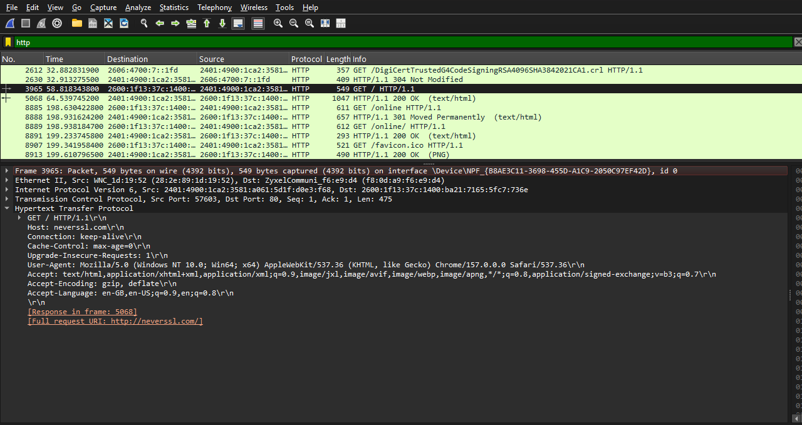
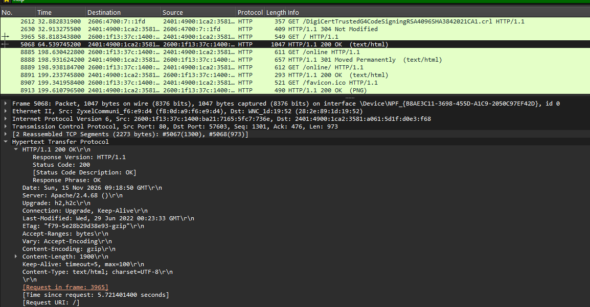
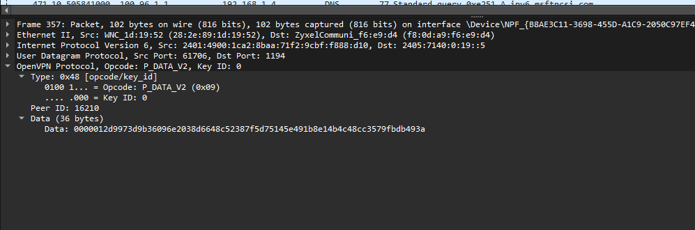
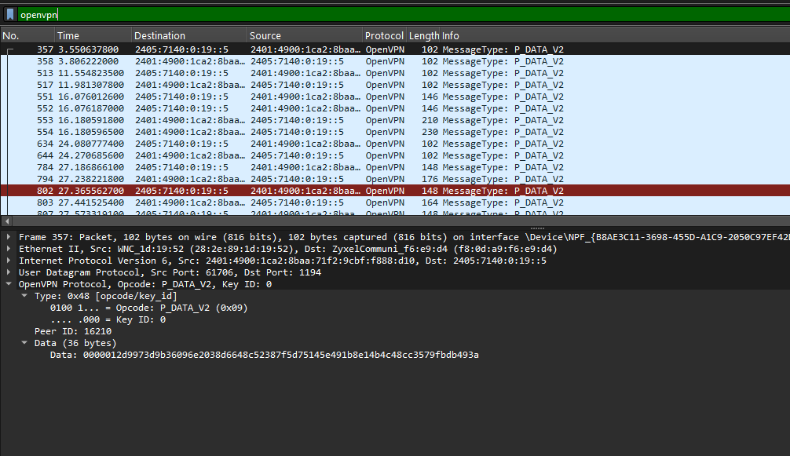

# Experiment 11: VPN Traffic vs. Unencrypted Communication

## 1. Aim

To capture and analyze unencrypted HTTP traffic and OpenVPN traffic using Wireshark, compare their characteristics, and understand how VPN encryption and split tunneling affect network communication.

## 2. Software and Tools Required

- **Operating System:** Windows 11
- **Packet Analyzer:** Wireshark
- **Web Browser:** Google Chrome
- **VPN Client:** OpenVPN Connect
- **VPN Service:** OpenVPN CloudConnexa
- **Websites:** `http://neverssl.com` and `http://example.com`
- **Code Editor:** Visual Studio Code

## 3. Theory

### 3.1 Unencrypted HTTP Communication

HTTP (Hypertext Transfer Protocol) is an application-layer protocol used for communication between web browsers and servers.

When HTTP is used without TLS encryption, the transmitted request and response data can be readable to someone who can capture the network traffic.

Wireshark can display information such as:

- HTTP request method
- Requested URL
- Host header
- HTTP response status
- Other transmitted headers and content

### 3.2 Virtual Private Network (VPN)

A Virtual Private Network creates an encrypted tunnel between a device and a VPN endpoint.

A VPN can help protect traffic passing through that tunnel from being read directly by observers on the underlying network.

However, the protection applies to traffic that is actually routed through the VPN.

### 3.3 OpenVPN Protocol

OpenVPN is a VPN protocol that uses encrypted communication to transport network traffic.

During this experiment, Wireshark identified OpenVPN packets using UDP port **1194**.

The captured OpenVPN traffic included:

- Protocol: OpenVPN
- Packet type: `P_DATA_V2`
- UDP destination port: `1194`
- Encrypted-looking binary payload

### 3.4 Split Tunneling

Split tunneling is a VPN configuration in which only selected traffic passes through the VPN tunnel.

Other traffic continues to use the device's normal internet connection.

Therefore, connecting to a VPN does not necessarily mean that all internet traffic is encrypted by that VPN.

## 4. Working Procedure

### Part A: Capture Unencrypted HTTP Traffic

**Step 1:** Open Wireshark and select the active Wi-Fi interface.

**Step 2:** Start capturing network packets.

**Step 3:** Open Google Chrome in Incognito mode.

**Step 4:** Visit:

`http://neverssl.com`

**Step 5:** Stop the Wireshark capture.

**Step 6:** Apply the display filter:

```text
http
```

**Step 7:** Select the HTTP GET request and expand the Hypertext Transfer Protocol section.

**Step 8:** Inspect the request method, host, headers, and response.

**Step 9:** Save the capture as:

`unencrypted_baseline.pcapng`

### Part B: Connect to OpenVPN

**Step 1:** Install and open OpenVPN Connect.

**Step 2:** Configure the VPN connection using OpenVPN CloudConnexa.

**Step 3:** Connect to the VPN.

**Step 4:** Verify that OpenVPN Connect displays:

`Securely Connected!`

### Part C: Capture VPN Traffic

**Step 1:** Start a new Wireshark capture on the active Wi-Fi interface.

**Step 2:** While the VPN is connected, visit:

`http://example.com`

**Step 3:** Stop the capture.

**Step 4:** Apply the HTTP display filter:

```text
http
```

**Step 5:** Observe whether HTTP packets are still visible.

**Step 6:** Apply the OpenVPN display filter:

```text
openvpn
```

**Step 7:** Select an OpenVPN packet and inspect its protocol fields and payload.

**Step 8:** Save the capture as:

`vpn_encrypted_capture.pcapng`

## 5. Captured Packet Details

### 5.1 Unencrypted HTTP Request

The HTTP baseline capture showed the following:

| Field | Observed Value |
|---|---|
| Packet number | 3965 |
| Protocol | HTTP |
| Request method | GET |
| Request URI | `/` |
| Host | `neverssl.com` |
| Full request URI | `http://neverssl.com/` |
| Destination TCP port | 80 |
| Encryption | No HTTP-layer encryption |

The HTTP request and headers were readable in Wireshark.

### 5.2 HTTP Response

| Field | Observed Value |
|---|---|
| Packet number | 5068 |
| Protocol | HTTP |
| Status | `200 OK` |
| Content-Type | `text/html; charset=UTF-8` |
| Server | Apache/2.4.68 |

This demonstrated that the HTTP response headers were also visible.

### 5.3 OpenVPN Packet

| Field | Observed Value |
|---|---|
| Packet number | 357 |
| Protocol | OpenVPN |
| Transport protocol | UDP |
| UDP source port | 61706 |
| UDP destination port | 1194 |
| OpenVPN packet type | `P_DATA_V2` |
| Key ID | 0 |
| Peer ID | 16210 |
| Data length | 36 bytes |

Wireshark identified the packet as OpenVPN traffic rather than a readable HTTP request.

### 5.4 HTTP Traffic Observed While VPN Was Connected

During the VPN-connected capture, the following HTTP request was also visible:

| Field | Observed Value |
|---|---|
| Packet number | 1509 |
| Protocol | HTTP |
| Source IP | 192.168.1.4 |
| Destination IP | 104.20.23.154 |
| Request method | GET |
| Host | `example.com` |
| Full request URI | `http://example.com/` |
| Destination TCP port | 80 |

An HTTP response with status `200 OK` was observed in packet **1514**.

This showed that the `example.com` HTTP request was not protected by the OpenVPN tunnel in the observed configuration.

## 6. Screenshots

### Screenshot 1: Unencrypted HTTP Request



**Observation:** The HTTP GET request and the `Host: neverssl.com` header were readable.

### Screenshot 2: Unencrypted HTTP Response



**Observation:** Wireshark displayed the HTTP response status `200 OK` and other response headers.

### Screenshot 3: OpenVPN Packet Analysis



**Observation:** Wireshark identified an OpenVPN `P_DATA_V2` packet carried over UDP port 1194.

### Screenshot 4: OpenVPN Traffic



**Observation:** Applying the `openvpn` filter displayed multiple VPN packets.

## 7. Analysis and Observations

### 7.1 Comparison of HTTP and OpenVPN Traffic

| Parameter | Unencrypted HTTP | OpenVPN Tunnel Traffic |
|---|---|---|
| Protocol observed | HTTP | OpenVPN |
| Transport observed | TCP | UDP |
| Port observed | 80 | 1194 |
| HTTP request headers | Readable | Not directly readable inside captured VPN packets |
| Payload appearance | Readable HTTP fields | Binary VPN payload |
| Encryption | No HTTP-layer encryption | VPN tunnel uses encryption |
| Wireshark filter | `http` | `openvpn` |

### 7.2 Important Finding: Split Tunneling

The VPN connection was successfully established using OpenVPN Connect.

However, the CloudConnexa dashboard indicated:

**Split Tunnel On**

The Windows routing table also showed that the default internet route continued through the local Wi-Fi gateway.

During the VPN-connected capture, Wireshark still displayed:

`GET / HTTP/1.1`

`Host: example.com`

This indicates that the observed HTTP request used the normal internet route instead of passing through the VPN tunnel.

**Therefore, the experiment demonstrated both encrypted VPN traffic and unencrypted HTTP traffic existing simultaneously on the same network interface.**

### 7.3 Difference Between Expected and Actual Results

The laboratory procedure expected that applying the `http` filter after enabling the VPN would show no readable HTTP traffic.

However, the actual capture showed HTTP requests and responses.

This difference was explained by the VPN's split-tunneling configuration.

The observation highlights the importance of checking routing configuration rather than assuming that every connection is protected simply because the VPN client reports a successful connection.

## 8. Result

The experiment successfully captured and analyzed:

1. Unencrypted HTTP request and response packets.
2. OpenVPN packets transmitted over UDP.
3. HTTP traffic that remained visible while the VPN was connected.

The captured packets demonstrated the difference between readable HTTP communication and OpenVPN tunnel traffic.

The experiment also confirmed that, under the observed split-tunneling configuration, not all internet traffic was routed through the VPN.

## 9. Conclusion

This experiment demonstrated how Wireshark can be used to analyze unencrypted HTTP traffic and OpenVPN communication.

The HTTP capture revealed readable request and response information, while the OpenVPN capture showed VPN protocol packets with binary payloads.

An important observation was that the VPN operated with split tunneling enabled. As a result, the HTTP request to `example.com` remained visible even while the VPN was connected.

Thus, VPN security depends not only on establishing an encrypted tunnel but also on ensuring that the intended traffic is routed through it.

## 10. Security Note

- HTTP communication without TLS can expose transmitted information.
- VPN encryption protects traffic routed through the VPN tunnel.
- Split tunneling can allow selected traffic to bypass the VPN.
- A VPN connection should not be assumed to protect all traffic without verifying routing behavior.
- Packet capture files may contain sensitive network information and should be handled carefully.

**Note:** Raw `.pcapng` captures and VPN configuration files are not included in this repository.