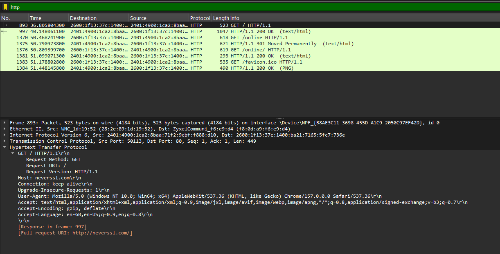
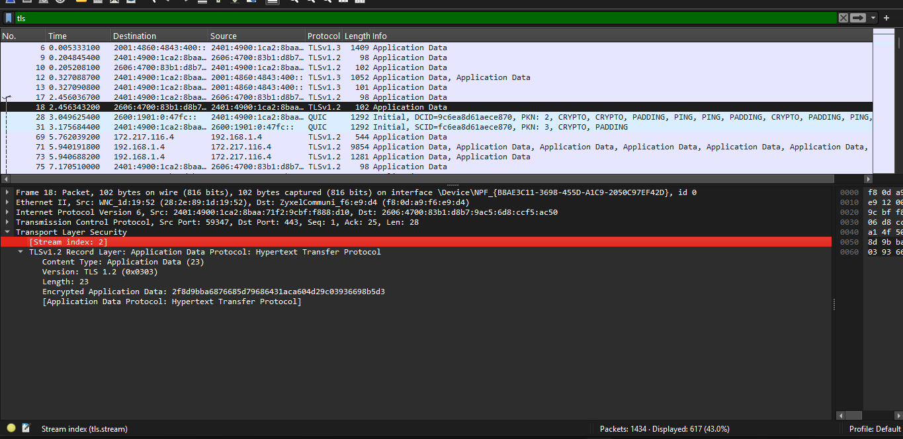
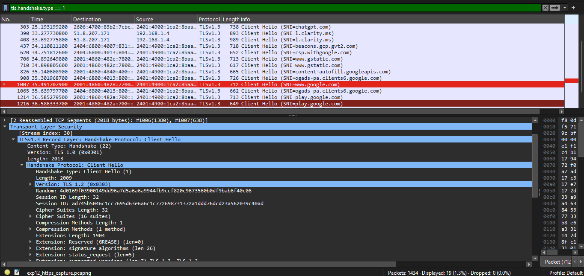
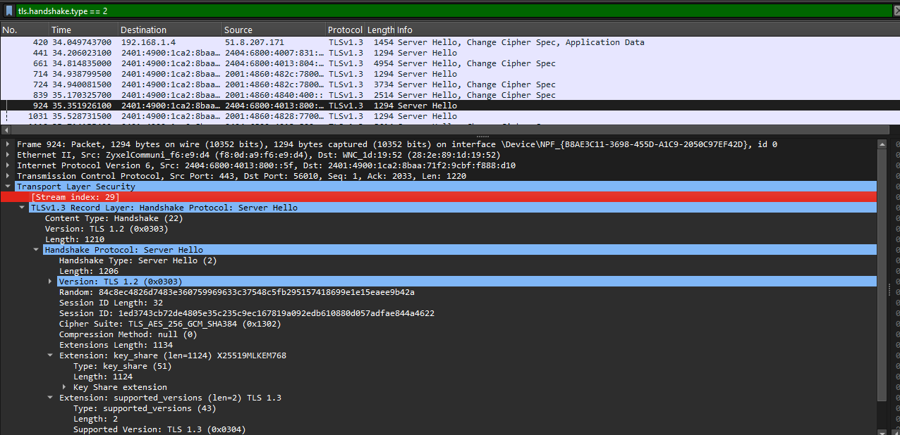

# Experiment 12: Analysis of Secure and Insecure Communication Protocols Using Wireshark

## 1. Aim

To capture and analyze HTTP and HTTPS network packets using Wireshark and compare insecure and secure communication.

## 2. Tools Required

- Wireshark
- Google Chrome
- Internet Connection
- Windows 11

## 3. Theory

### HTTP (Hypertext Transfer Protocol)

HTTP is an application-layer protocol used for communication between web browsers and web servers.

HTTP does not provide built-in encryption. Therefore, transmitted application data, including HTTP headers, may be visible in plaintext during packet analysis.

**Default Port:** 80

### HTTPS (Hypertext Transfer Protocol Secure)

HTTPS uses Transport Layer Security (TLS) to provide secure communication between clients and servers.

TLS encrypts application data and protects its confidentiality and integrity during transmission.

**Default Port:** 443

## 4. Procedure

### Part A: Analysis of Insecure HTTP Communication

**Website:** `http://neverssl.com/`

1. Open Wireshark.
2. Select the active Wi-Fi network interface.
3. Start capturing network packets.
4. Open `http://neverssl.com/` in Google Chrome.
5. Stop the capture after the website loads.
6. Apply the Wireshark display filter:

   ```text
   http
   ```

7. Select an HTTP GET request packet.
8. Expand the Hypertext Transfer Protocol section.
9. Observe the request method, host, URI, and other HTTP headers.

**Observation:**

The HTTP request headers were visible in plaintext.

The captured packet contained:

- Request Method: GET
- Request URI: /
- HTTP Version: HTTP/1.1
- Host: neverssl.com
- Destination Port: 80

### Screenshot 1: HTTP Request Headers



---

### Part B: Analysis of Secure HTTPS Communication

**Website:** `https://www.google.com/`

1. Start a new packet capture in Wireshark.
2. Open `https://www.google.com/` in Google Chrome.
3. Stop capturing after the website loads.
4. Apply the display filter:

   ```text
   tls
   ```

5. Select a TLS Application Data packet.
6. Expand the Transport Layer Security section.
7. Observe the encrypted application data.
8. Examine the Client Hello and Server Hello handshake packets.

### Screenshot 2: TLS Encrypted Application Data

**Display Filter:**

```text
tls
```

**Observation:**

The captured TLS Application Data packet showed encrypted application content.

- Protocol: TLSv1.2
- Content Type: Application Data (23)
- Destination Port: 443
- Application Data: Encrypted

The protected application content was not directly readable as plaintext.



---

### Screenshot 3: TLS Client Hello

**Display Filter:**

```text
tls.handshake.type == 1
```

**Observation:**

The Client Hello message was successfully identified.

- Handshake Type: Client Hello (1)
- Server Name: www.google.com
- Protocol: TLSv1.3
- Destination Port: 443

The Client Hello contains information used to negotiate a secure TLS connection.



---

### Screenshot 4: TLS Server Hello

**Display Filter:**

```text
tls.handshake.type == 2
```

**Observation:**

The Server Hello message was successfully identified.

- Handshake Type: Server Hello (2)
- Negotiated TLS Version: TLS 1.3
- Cipher Suite: TLS_AES_256_GCM_SHA384
- Source Port: 443

The Server Hello contains the selected parameters for establishing the secure connection.



---

## 5. Comparison of HTTP and HTTPS

| Feature | HTTP – NeverSSL | HTTPS – Google |
|---|---|---|
| Default Port | 80 | 443 |
| Encryption | No built-in encryption | TLS encryption |
| Application Data | May be readable in plaintext | Encrypted in transit |
| Confidentiality | Not provided by HTTP itself | Provided by TLS when correctly configured |
| Packet Analysis | HTTP headers and content may be visible | TLS handshake and connection metadata may be visible |
| Security | Vulnerable to eavesdropping and modification | Protects against eavesdropping and tampering in transit |

## 6. Result

HTTP traffic from NeverSSL and HTTPS traffic from Google were successfully examined using Wireshark.

The HTTP capture demonstrated that request headers were readable in plaintext.

The HTTPS capture showed TLS handshake messages and encrypted application data.

The experiment demonstrated that HTTP does not provide built-in encryption, whereas HTTPS uses TLS to protect application data during transmission.

## 7. Precautions

- Capture only authorized network traffic.
- Select the correct active network interface.
- Ensure website requests are generated during packet capture.
- Use the appropriate display filters for HTTP and TLS analysis.